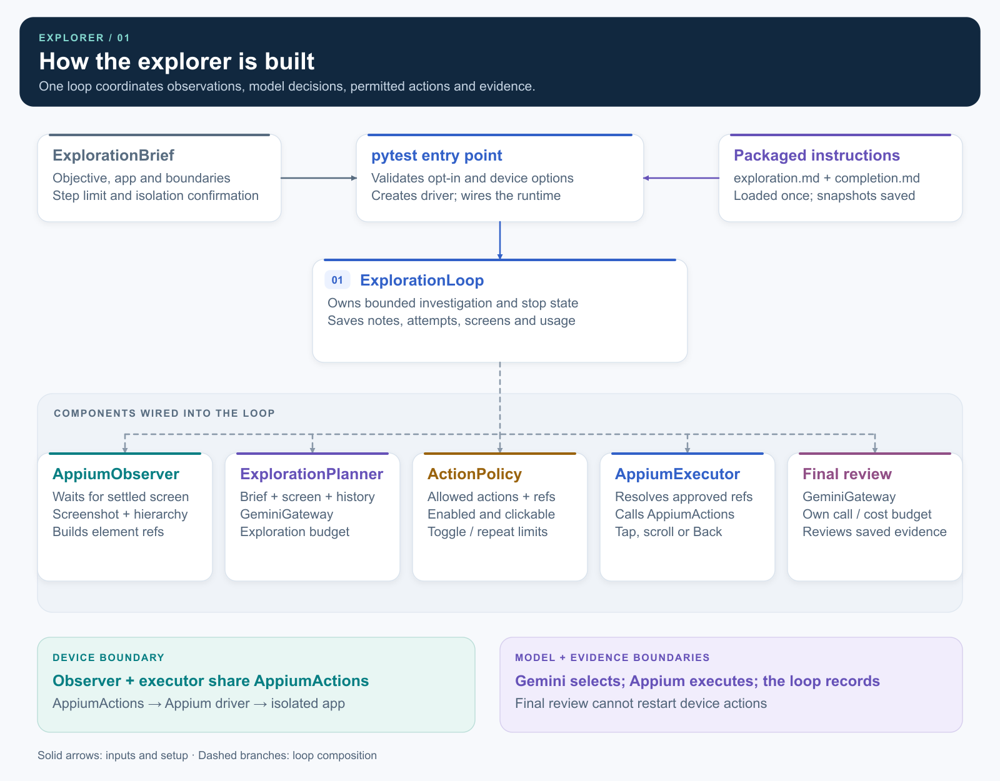
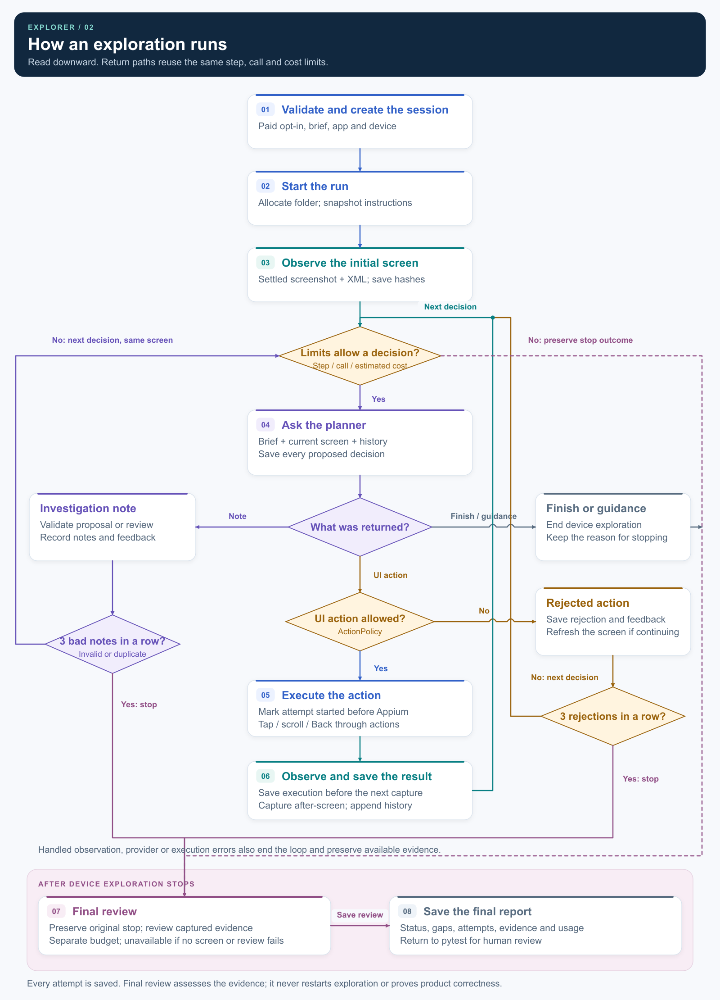

# Explorer architecture

[Workflow](../../README.md)

The explorer uses one loop to observe the app, ask Gemini for a decision,
validate it, execute a permitted action and save the evidence.

## How it is built

- **pytest** validates the selected brief and execution options, creates the driver and wires the components.
- **`ExplorationLoop`** coordinates the observer, planner, policy, executor and final reviewer.
- **Observer and executor** share `AppiumActions`; Gemini requests go through independently budgeted gateways.

## How a run proceeds

- **Notes** record a proposed scenario or evidence review without touching the app.
- **UI actions** require policy approval, then execution and a new observation.
- **Rejected decisions** are retained with feedback and consume the existing limits.
- **Stopping** preserves the exploration outcome and attempts final review when screenshots exist.
- **Final review** cannot restart exploration. The report is evidence for human review.

## Where it is implemented

| Part | Source |
| --- | --- |
| Entry point and component wiring | [test_exploratory_app.py](../../../tests/autotests/ui/exploration/test_exploratory_app.py) |
| Device and Appium lifecycle | [conftest.py](../../../tests/conftest.py) |
| Brief, planner, loop and report persistence | [exploration.py](../../../src/agentic_mobile_test/agent/exploration.py) |
| Observation and safe element references | [observer.py](../../../src/agentic_mobile_test/appium/observer.py) |
| Action permissions and repetition checks | [policy.py](../../../src/agentic_mobile_test/agent/policy.py) |
| Action dispatch and device operations | [executor.py](../../../src/agentic_mobile_test/appium/executor.py), [actions.py](../../../src/agentic_mobile_test/appium/actions.py) |
| Candidate notes and final review validation | [investigation.py](../../../src/agentic_mobile_test/agent/investigation.py), [completion.py](../../../src/agentic_mobile_test/agent/completion.py) |
| Gemini requests and budgets | [gemini.py](../../../src/agentic_mobile_test/gateways/gemini.py) |

Vector versions: [components](explorer-components.svg) and [execution flow](explorer-flow.svg).
